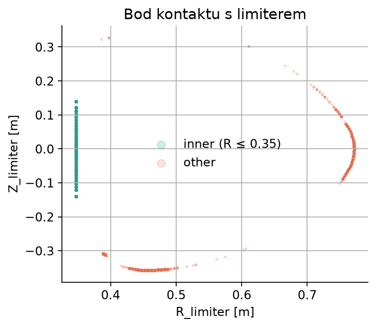
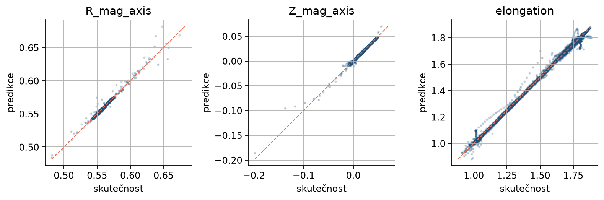
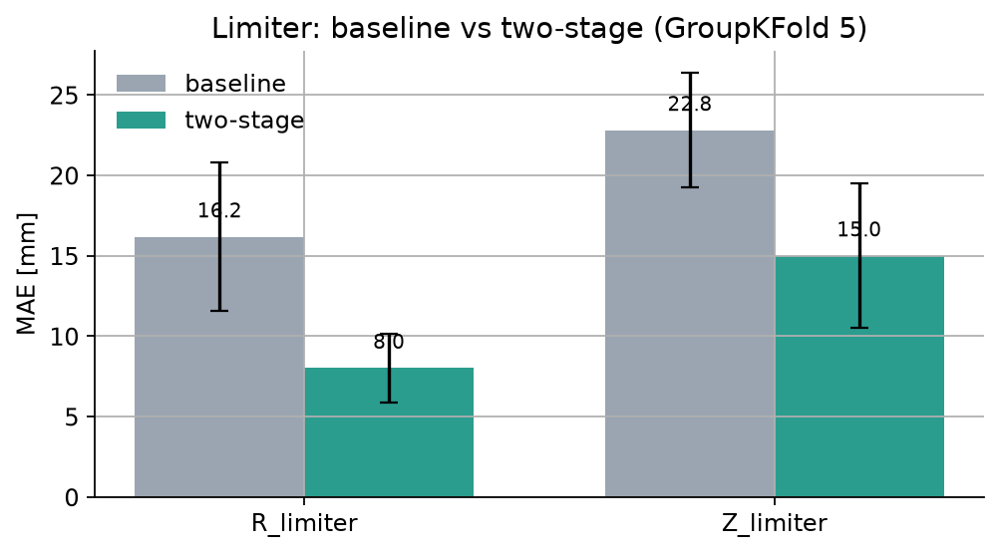

<!-- _class: lead -->

# Rekonstrukce tvaru plazmatu na tokamaku COMPASS

### Z magnetických diagnostik (a volitelně z kamery)

Hackathon 2026 · Děčín

---

## Cíl

Z 24 magnetických signálů (`IPR01–16`, `FL01–08`) předpovědět:

- **10 parametrů tvaru a polohy** plazmatu (R/Z osy, elongace, triangularita, a, …)
- **X-point a 2 strike points** (jen diverted plazma)
- **bod kontaktu s limiterem** `(R, Z)` (jen limited plazma)
- **binární režim** `is_limited`

 

| Data | Rozsah |
|---|---|
| `equil_data.csv` | 42 972 řádků · 149 výbojů · 57 sloupců |
| `camera_data.csv` | 116 142 snímků · 78 výbojů · 640×500 RGB |

---

## Fyzika dat: limited vs diverted

| Režim | Co plazma dělá | Vyplněné cíle |
|---|---|---|
| **limited** (`is_limited=True`) | dotýká se limiteru | `R_limiter`, `Z_limiter` |
| **diverted** (`is_limited=False`) | má X-point, jde na divertor | `R_x_point`, `Z_x_point`, strike points |

 

- Chybějící hodnoty **nejsou chyba dat** — jsou fyzikální.
- Limited: 19 012 řádků, diverted: 23 960 řádků.
- Strike points = místa, kde magnetické čáry z X-pointu dopadají na stěnu.
- `R_strike_point_1 < R_strike_point_2` (ověřeno na 100 % řádků).

---

## Limiter: jeden bod, dvě souřadnice

- `R_limiter` = radiální souřadnice
- `Z_limiter` = vertikální souřadnice
- **Není to „levý a pravý limiter“** — je to jedna kontaktní pointa `(R, Z)`.

 

- 73,4 % hodnot `R_limiter` je **0,347 m** → vnitřní prstenec.
- Zbytek tvoří jiné body stěny (R až 0,771 m).

---

## Metodika

- **Rozdělení podle výbojů**, ne po řádcích:
  - 119 výbojů train / 30 výbojů test
  - 33 902 / 9 070 řádků
- `time` a `discharge` **nejsou příznaky** (zadání).
- Kanonikalizace strike points podle R.
- Model: `StandardScaler` + **MLP 128×128**, standardizace cílů.
- Baseline: stejná architektura pro všechny skupiny cílů.
- Validace: **GroupKFold(5)** podle výbojů + jedno pevné rozdělení.

---

## Výsledky: tvar a poloha

| Cíl | MAE | R² |
|---|---|---|
| `R_mag_axis` | 0,34 mm | 0,985 |
| `Z_mag_axis` | 0,43 mm | 0,995 |
| `elongation` | 0,0058 | 0,998 |
| `a` | 0,50 mm | 0,992 |
| `plasma_current` | 1 021 A | 0,9996 |

 

GroupKFold(5): `R_mag_axis` 0,61 ± 0,19 mm · `Z_mag_axis` 0,70 ± 0,16 mm.

---

## X-point a strike points

| Cíl | MAE | R² |
|---|---|---|
| `R_x_point` | 0,24 mm | 0,9965 |
| `Z_x_point` | 0,27 mm | 0,9972 |
| `R_strike_point_1` | 0,30 mm | 0,9980 |
| `Z_strike_point_1` | 0,13 mm | 0,9972 |
| `R_strike_point_2` | 0,25 mm | 0,9953 |
| `Z_strike_point_2` | 0,06 mm | 0,9886 |

 

Všechny cíle mají **R² > 0,988** na 5 438 diverted řádcích testovacích výbojů.

---

## Klasifikace režimu `is_limited`

- MLP klasifikátor na stejných 24 příznacích.

 

| Metrika | Hodnota |
|---|---|
| Accuracy | **99,1 %** |
| Balanced accuracy | 99,1 % |
| F1 | 0,989 |
| ROC-AUC | **0,9996** |

 

Režim je z magnetických signálů prakticky dokonale rozlišitelný — dává smysl
použít ho jako první stupeň před regresí limiteru.

---

## Limiter: dvoustupňový model

1. Klasifikátor: inner (`R ≤ 0,35`) vs other.
2. Inner: `R = 0,347` (konstanta) + samostatný model pro `Z`.
3. Other: samostatné modely pro `R` a `Z`.

 

| Cíl | Baseline | Two-stage | Změna |
|---|---|---|---|
| `R_limiter` | 16,2 mm | **8,0 mm** | **−50,4 %** |
| `Z_limiter` | 22,8 mm | **15,0 mm** | **−34,2 %** |

---

## Negativní výsledek: `mode` jako příznak

Přidání one-hot `mode` (L/H/ELM) z kamery k magnetickým příznakům:

 

| Vyhodnocení | Změna průměrného MAE |
|---|---|
| Jedno pevné rozdělení | **−5,2 %** (zdánlivý zisk) |
| GroupKFold(5) | **+4,2 %** (zhoršení) |

 

Signál je nestabilní → model se přeučuje na konkrétní výboje.
**`mode` není ve finálním modelu.**

---

## Rychlost a omezení

**Rychlost**

- Trénink všech modelů: ~13 s
- Infernce všech modelů na 1 vzorku: **~1,5 ms**
- Vhodné pro real-time řízení

 

**Omezení**

- Jedna architektura (MLP), bez ladění hyperparametrů a ensemble.
- Jen magnetické příznaky; kamera zatím jen pro analýzu režimu.
- `R_limiter` R² ~0,68 je důsledek konstantní predikce pro inner režim.
- Testováno na 30 výbojích.

---

## Závěry

- **Tvar a poloha**: R² 0,985–0,9996, chyba centra < 0,5 mm.
- **X-point / strike points**: R² > 0,988.
- **Režim**: accuracy 99,1 %, ROC-AUC 0,9996.
- **Limiter**: dvoustupňový přístup snížil MAE o **34–50 %**.
- **Latence ~1,5 ms** → použitelné v reálném čase.
- **`mode`** jako příznak se neosvědčil.

 

### Další kroky

1. Odolnost proti šumu (`equil_data_noisy.csv`).
2. Camera CNN a multimodální fúze.
3. Rozšíření validace na více výbojů.
